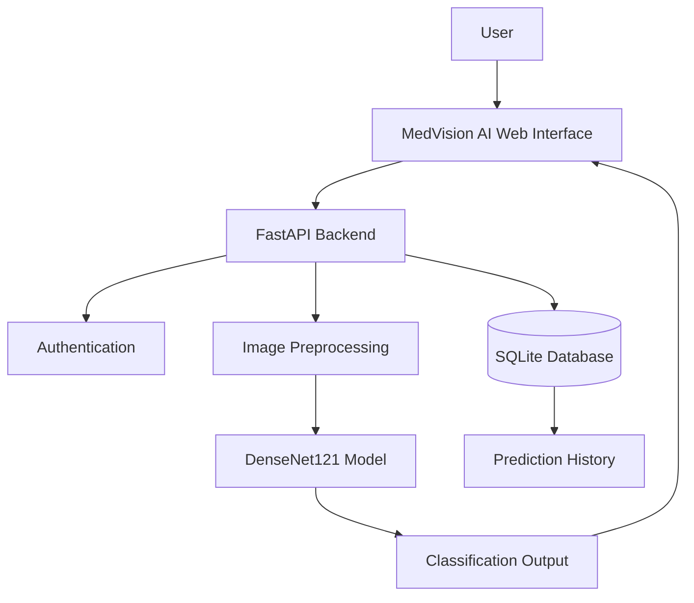

 <div align="center">

# 🏥 MedVision AI
### Intelligent Medical Imaging Research Prototype

**AI-Powered Chest X-Ray Classification · Full-Stack Web Application**

<p>
  
  
  
  
  
</p>

**A modern medical imaging research project combining computer vision, deep learning, and full-stack development to explore chest X-ray image classification.**

[Features](#-key-features) · [Architecture](#-system-architecture) · [Installation](#-installation) · [Performance](#-model-performance) · [Safety](#-medical-safety)

</div>

---

## 🖼️ Project Showcase

<div align="center">

<!-- Add your actual HD project screenshot at assets/medvision-dashboard.png -->


**MedVision AI — Research Dashboard**

*Replace the image path above with your actual dashboard screenshot.*

</div>

> 💡 **For the best GitHub presentation:** Upload clear, full-resolution screenshots of your dashboard, login page, image upload interface, and prediction results to the `assets/` folder.

## ✨ Key Features

| Feature | Description |
|---|---|
| 🧠 Deep Learning | DenseNet121-based chest X-ray classification |
| 🩻 Image Classification | Four research categories: COVID19, NORMAL, PNEUMONIA, and TB |
| 🔐 Authentication | User registration, password hashing, and JWT-based sessions |
| 📊 Model Evaluation | Confusion matrix and evaluation metrics |
| 🗂️ Prediction History | User-specific saved predictions, if enabled in the backend |
| ⚡ REST API | FastAPI endpoints with interactive API documentation |
| 🗄️ Database | SQLite-based data storage |
| 📱 Responsive UI | Modern interface designed for different screen sizes |

## 🛠️ Technology Stack

<div align="center">

| Layer | Technologies |
|---|---|
| Frontend | HTML5, CSS3, JavaScript |
| Backend | Python, FastAPI, Uvicorn |
| AI / Deep Learning | PyTorch, torchvision, DenseNet121 |
| Database | SQLite, SQLAlchemy |
| Authentication | JWT, password hashing |
| Evaluation | Confusion Matrix, Classification Metrics |

</div>

## 🏗️ System Architecture



*Architecture overview: confirm each component against your actual implementation before presenting this diagram as the deployed system.*

## 📊 Model Performance

The following figures are based on the supplied confusion matrix. They should be treated as reported evaluation results until independently verified against the evaluation code and dataset.

| Metric | Result |
|---|---:|
| Evaluation samples | 770 |
| Correct predictions | 710 |
| Overall accuracy | 92.21% |
| Model architecture | DenseNet121 |
| Input resolution | 224 × 224 |
| Output categories | 4 |

### Confusion Matrix

Rows represent true labels; columns represent predicted labels.

| Actual \ Predicted | COVID19 | NORMAL | PNEUMONIA | TB |
|---|---:|---:|---:|---:|
| **COVID19** | 101 | 0 | 0 | 5 |
| **NORMAL** | 0 | 196 | 37 | 1 |
| **PNEUMONIA** | 0 | 18 | 372 | 0 |
| **TB** | 0 | 0 | 0 | 41 |

**Important:** Accuracy alone does not establish clinical reliability. Evaluate per-class precision, recall, F1-score, and performance on independent test data before making stronger claims.

## 🚀 Installation

### 1. Clone the repository

```bash
git clone https://github.com/sikandarali2344/MedVision_AI_FullStack.git
cd MedVision_AI_FullStack
```

### 2. Create a virtual environment

**Windows — PowerShell**

```powershell
py -m venv .venv
.\.venv\Scripts\Activate.ps1
```

### 3. Install dependencies

```bash
python -m pip install --upgrade pip
pip install -r requirements.txt
```

### 4. Configure environment variables

If your repository contains `.env.example`:

```powershell
Copy-Item .env.example .env
```

Set a secure, unique `SECRET_KEY` in `.env`. Never commit real secrets or credentials to GitHub.

### 5. Start the application

If `backend/main.py` is the actual application entry point:

```bash
uvicorn backend.main:app --reload
```

Open these addresses in your browser:

- **Application:** http://127.0.0.1:8000
- **API documentation:** http://127.0.0.1:8000/docs

*Adjust the commands if your actual folder structure or entry point differs.*

## 📡 API Endpoints

The following endpoints describe the intended API structure. Verify their availability in your backend before relying on them.

| Method | Endpoint | Purpose |
|---|---|---|
| GET | `/api/health` | Service health check |
| GET | `/api/model/status` | Model loading status |
| POST | `/api/auth/register` | User registration |
| POST | `/api/auth/login` | User authentication |
| GET | `/api/auth/me` | Current user information |
| POST | `/api/predict` | Submit an image for prediction |
| GET | `/api/predictions` | Retrieve saved predictions |

## 📁 Suggested Repository Structure

```text
MedVision_AI_FullStack/
├── backend/
│   ├── main.py
│   ├── models/
│   └── ...
├── assets/
│   ├── medvision-dashboard.png
│   ├── medvision-login.png
│   └── medvision-upload.png
├── artifacts/
├── requirements.txt
├── .env.example
├── .gitignore
├── LICENSE
└── README.md
```

*This is a suggested layout. Keep your existing filenames and folders if they differ.*

## 🔬 Research Scope

MedVision AI explores the integration of a convolutional neural network with a web-based medical imaging workflow. Its purpose is to demonstrate image preprocessing, model inference, API development, and model evaluation within a research-oriented software prototype.

## ⚠️ Medical Safety

**MedVision AI is a research and educational prototype, not a clinically validated diagnostic system.**

- Predictions may be incorrect or uncertain.
- Do not use model outputs to diagnose a patient or guide treatment.
- Clinical use would require rigorous independent validation, appropriate regulatory review, and qualified medical oversight.
- Verify model preprocessing, class ordering, and evaluation methodology against the original training pipeline.

## 👨‍💻 Author

**Sikandar Ali**

<p>
  <a href="https://github.com/sikandarali2344">
    
  </a>
  <a href="https://www.linkedin.com/in/sikandar-ali-marri-a02128338">
    
  </a>
  <a href="https://sikandario.netlify.app">
    
  </a>
</p>

## 📄 License

This project is distributed under the MIT License if the repository's `LICENSE` file specifies that license.

---

<div align="center">

### ⭐ MedVision AI

**Advancing medical imaging research through AI and software engineering.**

*Built for research, learning, and responsible experimentation.*

</div>
